<p align="center">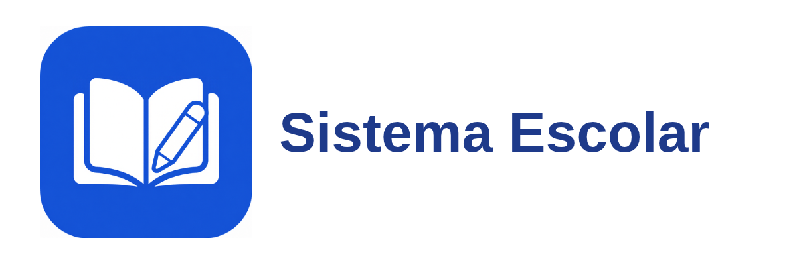</p>

<p align="center">Sistema de gestão escolar, do ensino fundamental ao doutorado, em um único app web.</p>

<p align="center">
  
  
  
  
  
  
</p>

<p align="center">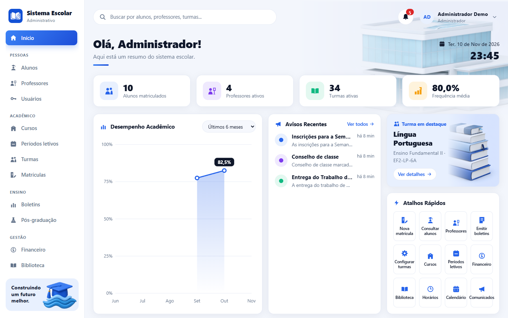</p>

## Sumário

- [Visão geral](#visão-geral)
- [Funcionalidades](#funcionalidades)
- [Telas](#telas)
- [Instalação rápida](#instalação-rápida)
- [Primeiro acesso](#primeiro-acesso)
- [Dados de demonstração](#dados-de-demonstração)
- [Configuração](#configuração)
- [Arquitetura](#arquitetura)
- [Desenvolvimento](#desenvolvimento)
- [Contribuindo](#contribuindo)
- [Segurança](#segurança)
- [Licença](#licença)

## Visão geral

O Sistema Escolar reúne cadastros, matrícula, vida acadêmica, notas e frequência, pós-graduação, financeiro, horários, biblioteca e comunicados em um único app web. Ele serve a escolas e instituições de ensino que querem tudo em um lugar só, e funciona no computador e no celular.

Cobre os oito níveis de ensino:

- Ensino fundamental I e II
- Ensino médio
- Ensino técnico
- Graduação
- Especialização
- Mestrado
- Doutorado

As regras de aprovação seguem o nível: frequência mínima de 75% e média mínima 6 para os níveis básicos, técnico e graduação; média mínima 7 para especialização, mestrado e doutorado.

Um único app tem três portais, escolhidos pelo perfil do usuário no login:

- **Administrativo** (perfis administrador, TI e secretaria): cadastros, matrículas, cursos, turmas, financeiro, biblioteca, horários, calendário e comunicados.
- **Professor**: minhas turmas, diário de classe, orientações, biblioteca, horário, calendário e comunicados.
- **Aluno**: matrícula e inscrição em disciplinas, boletim, histórico, pesquisa (pós-graduação), mensalidades, biblioteca, horário, calendário e comunicados.

## Funcionalidades

**Administrativo**

- Cadastros de alunos e professores, com ficha completa de cada um
- Cursos, períodos letivos e turmas
- Matrícula com pré-requisitos e controle de vagas
- Boletins, pós-graduação com bancas, financeiro e biblioteca
- Horários, calendário, comunicados e busca geral
- Painel com indicadores e gráfico
- Perfil TI, com o mesmo acesso do administrador
- Configurações da plataforma (só administrador e TI): nome, slogan, logo e cores, aplicados na tela de entrada e no menu
- Atualização pelo painel (só administrador e TI): verifica o último commit do GitHub e atualiza o sistema, sem mexer no banco de dados
- E-mails da plataforma, com teste de envio e histórico: recuperação de senha, boas-vindas a novos usuários, comunicados e respostas do suporte
- Painel "Atividades" com o registro de ações em tempo real, visível só para administrador e TI; os registros são guardados por 90 dias
- Cópia de segurança do banco (só administrador e TI): cópia automática diária, criar, baixar, enviar um arquivo e restaurar
- Importar planilhas (CSV) de alunos e professores, com modelo, conferência antes de gravar e importação tudo ou nada
- Exportar para CSV, que abre direto no Excel em português, as listas e tabelas do sistema

**Professor**

- Diário de classe com notas e frequência
- Orientações de pós-graduação
- Horário, calendário, biblioteca e comunicados

**Aluno**

- Matrícula e inscrição em disciplinas
- Boletim e histórico
- Mensalidades e biblioteca
- Horário, calendário e comunicados

**Geral**

- Biblioteca com capas de livros, com alternância entre tabela e cartões
- Calendário em grade mensal
- Perfil com medalhas, nível e foto
- Suporte por chamados (tickets), com atendimento por categoria
- Fórum com comunidades, votos e comentários
- Chat privado entre usuários, com conversas individuais e grupos, imagens, confirmação de entrega e de leitura, "digitando...", quem está online, respostas citando uma mensagem e apagar a própria mensagem
- Central de notificações (o sino): avisos de comunicados, chamados, fórum, notas, financeiro, medalhas e biblioteca, com marcação de lido e link direto
- Recuperação de senha pelo próprio e-mail, com link de uso único
- Temas claro e escuro
- Uso no celular, com opção de instalar como app (PWA)

## Telas

<p align="center">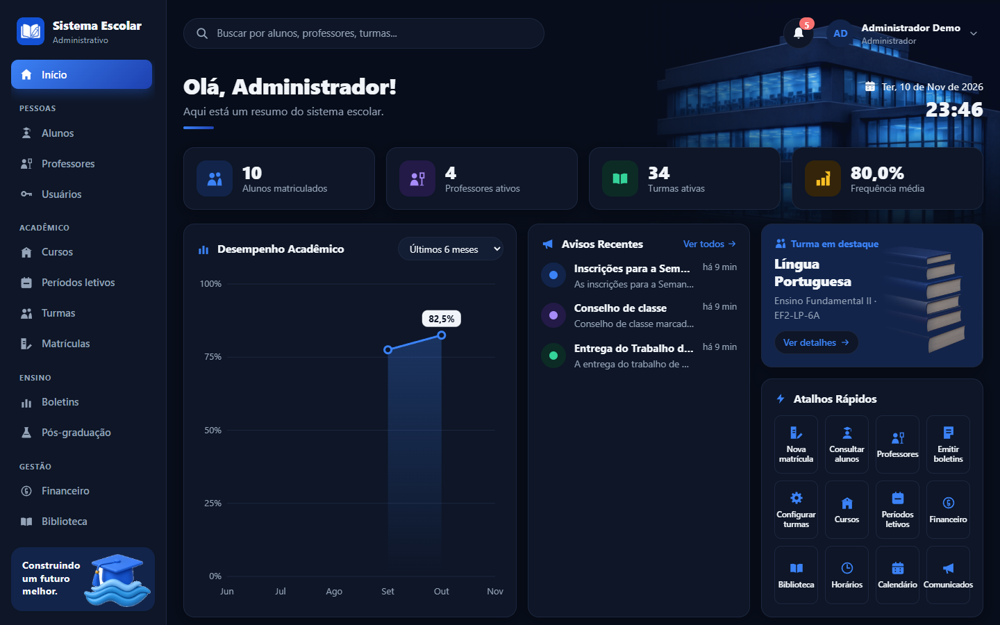</p>
<p align="center"><em>Painel administrativo no tema escuro.</em></p>

<p align="center">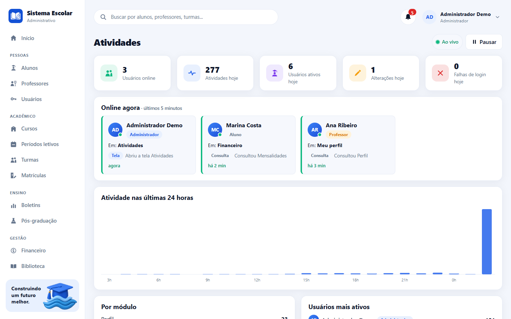</p>
<p align="center"><em>Painel de atividades, com o registro de ações em tempo real.</em></p>

<p align="center">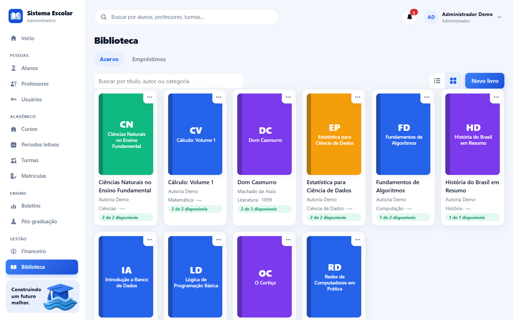</p>
<p align="center"><em>Acervo da biblioteca, com capas em cartões.</em></p>

<p align="center">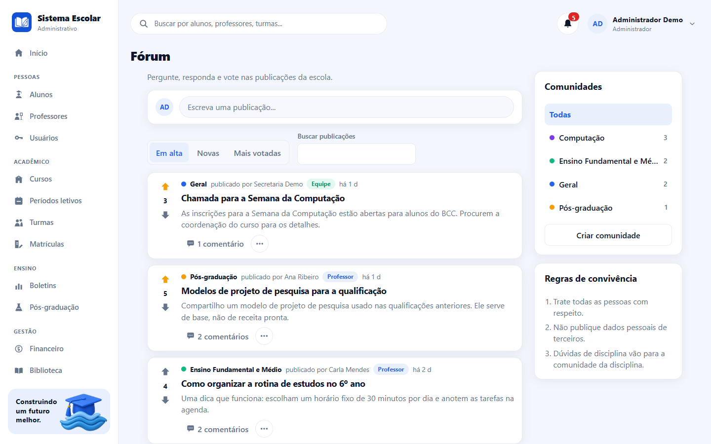</p>
<p align="center"><em>Fórum, com comunidades, votos e comentários.</em></p>

<p align="center">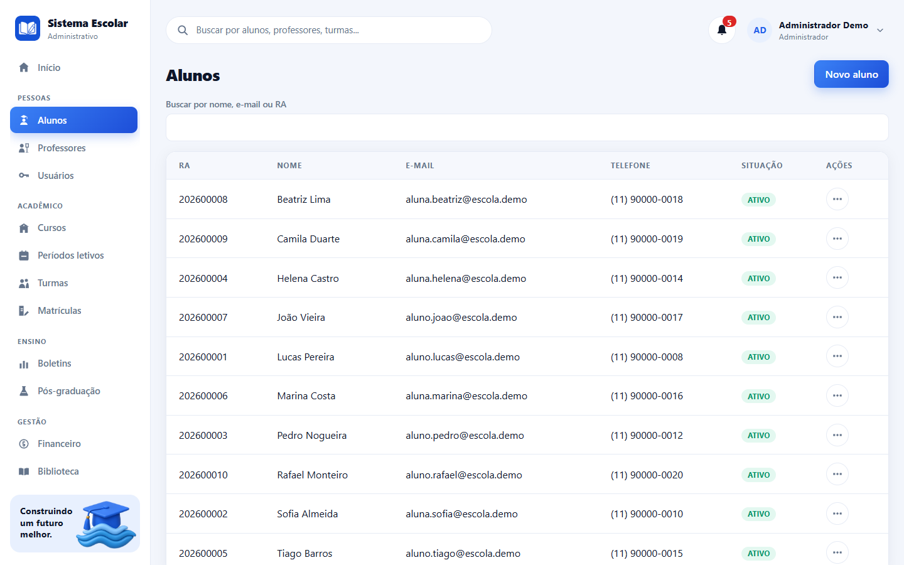</p>
<p align="center"><em>Lista de alunos, com menu de ações em cada linha.</em></p>

<p align="center">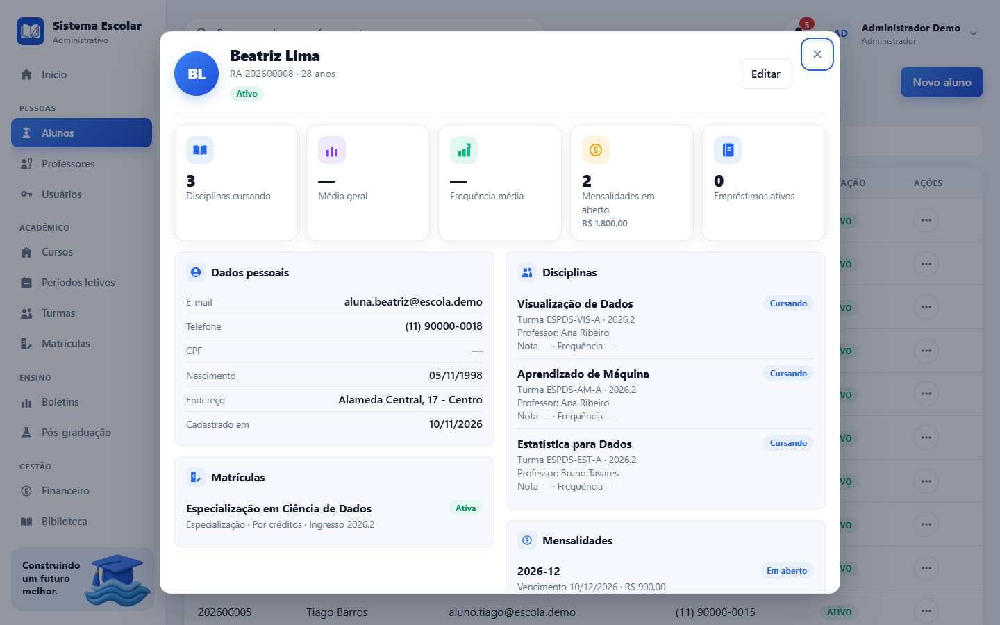</p>
<p align="center"><em>Ficha do aluno, um painel com o resumo de tudo sobre ele.</em></p>

<p align="center">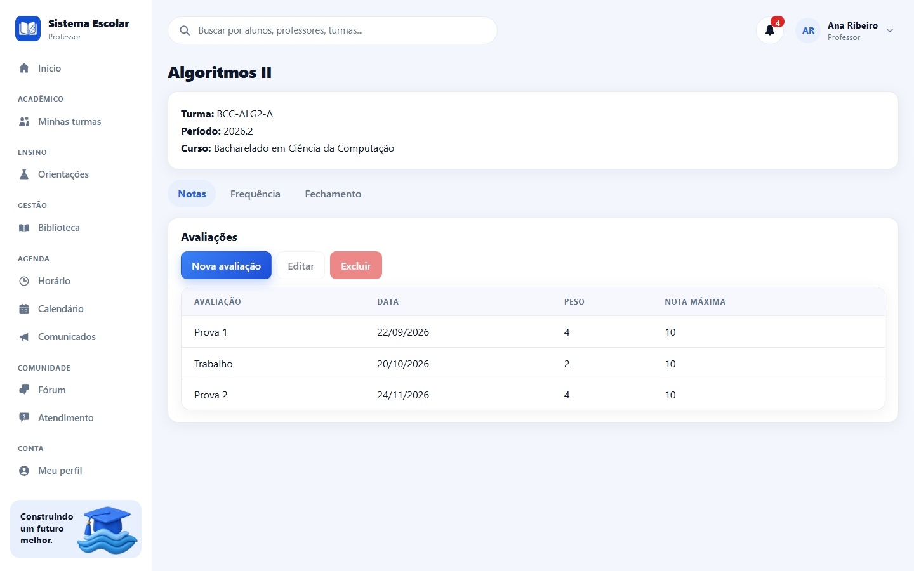</p>
<p align="center"><em>Diário do professor, com notas e frequência.</em></p>

<p align="center">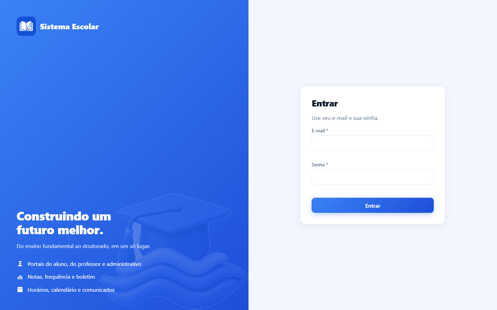</p>
<p align="center"><em>Tela de entrada.</em></p>

<p align="center">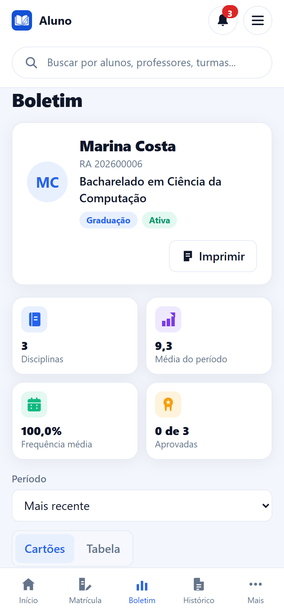</p>
<p align="center"><em>Boletim do aluno em tela de celular.</em></p>

Os dados mostrados nas telas são fictícios.

## Instalação rápida

Requisitos: nada além do **Docker Desktop** (e do **Git**, para baixar o projeto). O instalador confere o Docker, oferece instalar o que faltar, cria o arquivo `.env` com segredos aleatórios, baixa todas as dependências e sobe o sistema.

**Windows (PowerShell):**

```powershell
git clone https://github.com/marco3079/sistema-escolar.git
cd sistema-escolar
powershell -ExecutionPolicy Bypass -File .\instalar.ps1
```

**Linux e macOS (terminal):**

```bash
git clone https://github.com/marco3079/sistema-escolar.git
cd sistema-escolar
bash instalar.sh
```

No fim da instalação, o instalador mostra o endereço do site (por padrão `http://localhost:8090`) e o e-mail do administrador.

Para um passo a passo para quem não é programador, veja [INSTALAR.md](INSTALAR.md).

### Como atualizar

Pelo próprio sistema: entre como administrador ou TI e abra **Configurações → Atualização**.

1. Clique em **Verificar agora** para buscar as novidades no GitHub. A tela mostra a versão instalada, a última versão do repositório e a lista do que vem nela.
2. Se houver novidades, clique em **Atualizar agora** e confirme.

O sistema baixa o código novo (só avanço rápido, a partir do ramo atual do repositório), reconstrói a API e o site e os reinicia. A tela acompanha cada etapa e mostra o registro do que está acontecendo. Leva alguns minutos, e as pessoas conectadas podem ser desconectadas por instantes. Quando terminar, clique em **Recarregar a página**.

O banco de dados não é tocado: nenhum dado é apagado. Se a pasta tiver alterações locais que conflitem com o código novo, a atualização para com a mensagem do Git e nada se perde.

Alternativa manual: na pasta do projeto, rode `git pull` e depois o instalador de novo (`.\instalar.ps1` no Windows ou `bash instalar.sh` no Linux e macOS). Se a tela avisar que o próprio serviço de atualização mudou, o instalador também precisa ser rodado de novo.

### Instalar com um assistente de IA

Se você usa um assistente com acesso ao terminal (Claude Code, Cursor, Copilot ou outro), cole este texto nele:

> Instale o sistema escolar do repositório https://github.com/marco3079/sistema-escolar neste computador seguindo o arquivo AGENTS.md do repositório. Ao terminar, me diga o endereço para abrir no navegador e o e-mail e a senha do administrador.

As instruções para o assistente estão em [AGENTS.md](AGENTS.md).

## Primeiro acesso

Na primeira subida, o sistema cria uma única conta: a do **administrador**. O e-mail dela fica na variável `ADMIN_EMAIL` do arquivo `.env`. A senha inicial é **`admin1234`**, com o e-mail padrão **`admin@escola.local`**. O instalador grava essa senha em `ADMIN_SENHA` no arquivo `.env`. Se quiser outra senha inicial, defina `ADMIN_SENHA` com 8 caracteres ou mais antes da primeira subida. Se `ADMIN_SENHA` estiver vazia ou tiver menos de 8 caracteres, vale a senha padrão.

1. Abra o endereço do site e entre com o e-mail e a senha padrão do administrador.
2. Troque a senha em **Meu perfil** logo no primeiro acesso.
3. Cadastre o período letivo, os cursos, os professores, as turmas e os alunos.

O sistema começa vazio, só com a conta do administrador.

## Dados de demonstração

Para testar com uma escola fictícia, use a opção de demonstração numa instalação nova:

- Windows: `powershell -ExecutionPolicy Bypass -File .\instalar.ps1 -Demo`
- Linux e macOS: `bash instalar.sh --demo`

Os acessos de demonstração usam o domínio `escola.demo` e estão definidos em `server/prisma/seed-demo.ts`. Os dados são fictícios e servem só para teste.

## Configuração

O arquivo `.env` na raiz do projeto é lido pelo Docker Compose. O instalador cria esse arquivo; para ajustar à mão, copie o `.env.example`.

| Variável | Padrão | Para que serve |
|---|---|---|
| `POSTGRES_PASSWORD` | `escola` | Senha do banco de dados |
| `JWT_SECRET` | `troque-este-segredo-de-exemplo` | Segredo que assina os logins |
| `ADMIN_NOME` | `Administrador` | Nome da conta de administrador criada na primeira subida |
| `ADMIN_EMAIL` | `admin@escola.local` | E-mail da conta de administrador |
| `ADMIN_SENHA` | `admin1234` | Senha inicial do administrador (8 caracteres ou mais; vazia ou curta usa `admin1234`). Troque em Meu perfil depois do primeiro acesso |
| `SEED_DEMO` | `false` | `true` carrega os dados de demonstração (só para teste) |
| `WEB_PORT` | `8090` | Porta do site |
| `API_PORT` | `3090` | Porta da API, publicada somente em `127.0.0.1` |
| `DB_PORT` | `5432` | Porta do banco, publicada somente em `127.0.0.1` |
| `FUSO_HORARIO` | `America/Sao_Paulo` | Fuso da API. A hora da cópia automática segue este fuso |

Os valores padrão são exemplos. Os instaladores geram segredos aleatórios no `.env`. Não envie o `.env` para o Git.

### Como conectar um e-mail

Entre como administrador e abra **Configurações**, no menu, na seção Sistema, e depois a aba **E-mail**. Preencha o endereço do site (por exemplo, `http://localhost:8090`, ou o endereço público, se houver), o servidor de envio (SMTP) e a porta, o usuário e a senha da conta de e-mail, e o e-mail e o nome do remetente. Marque **Envio de e-mails ligado** e escolha quais avisos saem. A porta 587 costuma usar conexão comum que passa a TLS (deixe **Conexão segura** desmarcada); a porta 465 usa TLS direto (marque **Conexão segura**). Contas com verificação em duas etapas costumam exigir uma **senha de aplicativo**, em vez da senha comum. Depois de salvar, use **Enviar e-mail de teste** com um endereço seu: a tela mostra se o envio deu certo ou o erro devolvido pelo servidor, e o histórico de envios aparece embaixo. A senha fica guardada cifrada e não volta para a tela; deixe o campo em branco para manter a senha atual.

### Cópia de segurança

Entre como administrador e abra **Configurações**, na seção Sistema, e depois a aba **Cópia de segurança**.

- **Onde fica**: no próprio servidor, no volume `dados_backups` do Docker. Cada cópia é um arquivo `.sql.gz` com todos os dados do sistema.
- **Automática**: uma cópia por dia, na hora escolhida (padrão 3h), guardando as 7 mais recentes. Ajuste a hora e a quantidade na mesma tela e clique em **Salvar**.
- **Criar agora**: o botão **Criar cópia agora** faz uma cópia manual na hora.
- **Baixar**: no menu de ações de cada cópia, **Baixar** salva o arquivo no seu computador.
- **Restaurar**: no menu da cópia, **Restaurar** substitui todos os dados pelos da cópia (usuários e senhas inclusive). Antes, o sistema guarda uma cópia do estado atual. Para confirmar, digite `RESTAURAR`. Depois, é preciso entrar de novo.
- **Enviar**: **Enviar arquivo de cópia** traz um `.sql.gz` de outro computador, para restaurar ali.

Recomendação: guarde as cópias baixadas fora do computador onde o sistema roda (um pendrive, outro disco ou a nuvem). As cópias não são cifradas e ficam no mesmo computador do sistema. Veja [SECURITY.md](SECURITY.md).

## Arquitetura

O sistema roda em quatro contêineres, orquestrados pelo `docker-compose.yml`:

- **`db`**: PostgreSQL 16.
- **`api`**: API em Node.js 20 e TypeScript (Express e Prisma). Na subida, aplica o esquema do banco e cria o administrador.
- **`web`**: o app React servido pelo nginx, que também encaminha `/api` para a API.
- **`atualizador`**: serviço do botão de atualizar. Baixa o código novo do GitHub e reconstrói e reinicia a API e o site. Não publica porta e tem acesso ao Docker do computador (veja [SECURITY.md](SECURITY.md)).

Estrutura de pastas:

```
sistema-escolar/
  docker-compose.yml
  instalar.ps1 / instalar.sh   instaladores (Windows e Linux/macOS)
  server/                      API (Node 20, TypeScript, Express, Prisma)
  client/                      aplicativo web (React, TypeScript, Vite)
  docs/                        documentação técnica e imagens
```

Tecnologias:

- **API**: Node.js 20, TypeScript, Express 4, Prisma 5, zod, JWT, bcryptjs
- **Aplicativo**: React 18, TypeScript, Vite 5, react-router-dom 6
- **Banco de dados**: PostgreSQL 16
- **Implantação**: Docker Compose, nginx

Para os detalhes, veja [docs/ARQUITETURA.md](docs/ARQUITETURA.md) e [docs/API.md](docs/API.md).

## Desenvolvimento

Para desenvolver sem contêineres de aplicação, suba só o banco pelo Compose e rode a API e o app com o Node.js 20:

```bash
# 1) banco (PostgreSQL publicado só em 127.0.0.1, na porta DB_PORT)
docker compose up -d db

# 2) API
cd server
cp .env.example .env
npm install
npm run db:push
npm run seed
npm run dev

# 3) aplicativo web
cd ../client
npm install
npm run dev
```

Com o app em modo de desenvolvimento, abra `http://localhost:5173`.

O comando `npm run seed` cria o administrador (com `ADMIN_EMAIL` e `ADMIN_SENHA` do `server/.env`). Se `ADMIN_SENHA` estiver vazia ou curta, o administrador entra com o e-mail `admin@escola.local` e a senha padrão `admin1234`, que aparece no terminal. Troque a senha em Meu perfil depois do primeiro acesso.

Se mudar `DB_PORT`, ajuste também a `DATABASE_URL` do `server/.env` para a mesma porta.

Verificações antes de enviar uma mudança:

```bash
cd server && npx tsc --noEmit
cd client && npx tsc --noEmit && npx vite build
```

## Contribuindo

Sugestões e correções são bem-vindas. Veja [CONTRIBUTING.md](CONTRIBUTING.md).

## Segurança

Para relatar uma vulnerabilidade, siga as instruções em [SECURITY.md](SECURITY.md).

## Licença

Este projeto é distribuído sob a licença MIT. Veja o arquivo [LICENSE](LICENSE).
