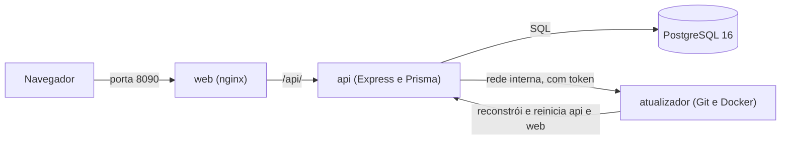

# Arquitetura

Este documento descreve como o sistema escolar é montado por dentro: os contêineres, a forma como a API e o site carregam seus módulos, a autenticação, as telas e o modelo de dados.

## Visão geral dos contêineres

O Docker Compose sobe quatro contêineres:

| Contêiner | Imagem ou build | Função | Porta |
|---|---|---|---|
| `db` | `postgres:16-alpine` | Banco de dados PostgreSQL | `127.0.0.1:5432` (só no computador) |
| `api` | build de `server/` | API HTTP (Node 20, Express 4, Prisma 5) | `127.0.0.1:API_PORT` (padrão 3090), só no computador |
| `web` | build de `client/` | Site estático servido pelo nginx | `WEB_PORT` (padrão 8090) |
| `atualizador` | build de `atualizador/` (Docker CLI com Git e Node) | Baixa a versão nova do GitHub e reconstrói a API e o site | nenhuma; só a API o acessa, pela rede interna |

O nginx do contêiner `web` entrega os arquivos do site e encaminha as requisições de `/api/` para o contêiner `api`. Por isso, o navegador só precisa falar com uma porta do site.



O banco de dados e a porta direta da API são publicados somente em `127.0.0.1`, ou seja, só o próprio computador os acessa. O site (`WEB_PORT`) é publicado em todas as interfaces, por isso pode ser aberto pela rede local (no celular, por exemplo), e também encaminha `/api`.

## Estrutura de pastas

```
server/
  prisma/schema.prisma           modelo de dados (fonte da verdade)
  prisma/seed.ts                 cria a conta de administrador na primeira subida
  prisma/seed-demo.ts            dados de demonstração (opcionais)
  src/server.ts                  sobe o servidor HTTP
  src/app.ts                     monta os middlewares e carrega os módulos
  src/lib/                       código compartilhado (erros, autenticação, regras)
  src/modules/<modulo>/routes.ts rotas de cada módulo
client/
  src/main.tsx, src/App.tsx      ponto de entrada e tabela de rotas
  src/lib/                       API, autenticação, tipos, rotas e busca de dados
  src/ui/                        componentes visuais e estilo.css
  src/layout/                    casca do app (barra lateral, topo, menu), painel e login
  src/modules/<modulo>/index.tsx telas de cada módulo
```

## Como a API carrega os módulos

O arquivo `server/src/app.ts` percorre as pastas de `server/src/modules/` em ordem alfabética. Cada pasta que tem um `routes.ts` é carregada. As regras são:

- Um módulo pode exportar `publico`, um roteador sem autenticação. Hoje, o módulo `auth` usa isso para o login, o teste de saúde e a senha por e-mail, e o módulo `plataforma` para `GET /api/plataforma`, o manifesto do app e a logo.
- O `default` do módulo é um roteador do Express montado em `/api` com o middleware `autenticar`, que exige o token JWT.
- As rotas fixas (por exemplo, `/turmas/minhas`) são declaradas antes das rotas com parâmetro (`/turmas/:id`), para não haver conflito.
- Rotas que não existem recebem `404` com `{ "erro": "Rota não encontrada" }`.

Erros passam por um tratador único, que responde:

- `HttpError` (usado pelo código das rotas): o status e a mensagem definidos na hora do erro.
- Violação de chave única do Prisma: `409`.
- Registro não encontrado no Prisma: `404`.
- JSON mal formado: `400`.
- Qualquer outro erro: `500` com `{ "erro": "Erro interno" }`, e o detalhe vai só para o log do servidor.

Os blocos de código compartilhados ficam em `server/src/lib/`:

- `erros.ts`: `HttpError`, `asyncHandler`, `idParam` e `validar` (com validação por zod).
- `auth.ts`: `autenticar`, `permitir(...perfis)` e a geração do token.
- `regras.ts`: frequência mínima, média mínima por nível e a situação final da inscrição.
- `prisma.ts`: o cliente do Prisma, único para todo o servidor.

## Autenticação e perfis

- O login (`POST /api/auth/login`) recebe e-mail e senha, confere o hash da senha com bcrypt e devolve um JWT e os dados do usuário.
- As rotas protegidas esperam o cabeçalho `Authorization: Bearer <token>`.
- O token carrega o id do usuário, o perfil, o id do aluno e o id do professor (quando houver). Assim, as rotas sabem quem está logado sem consultar a tabela de usuários a cada passo. O token vale por 12 horas.
- O login tem limite de tentativas: 10 falhas em 10 minutos para o mesmo endereço de IP e e-mail fazem as próximas tentativas receberem `429` até a janela passar.
- `permitir(...)` responde `403` quando o perfil do usuário não está na lista da rota.

Há cinco perfis:

| Perfil | Portal | Resumo |
|---|---|---|
| `ADMIN` | Administrativo | Acesso total, inclusive usuários, reabertura de turmas e o log de atividades. |
| `TI` | Administrativo | Mesmo acesso do `ADMIN`. No servidor, o `TI` é tratado como `ADMIN` nas permissões. O perfil real continua no token e aparece no log e no menu do usuário. |
| `SECRETARIA` | Administrativo | Cadastros, matrículas, financeiro e comunicados. Não gerencia usuários. |
| `PROFESSOR` | Professor | Suas turmas, diário, notas, frequência, orientações. |
| `ALUNO` | Aluno | Seus dados, matrícula, boletim, histórico, financeiro e biblioteca. |

Algumas rotas aplicam regras além do perfil, dentro do código. Exemplos: um professor só lança notas nas turmas dele, e um aluno só vê as próprias matrículas.

## Log de atividades

O servidor registra a atividade dos usuários em uma tabela própria (`LogAtividade`), que é consultada pelas telas Atividades e Log do sistema, só para ADMIN e TI.

- Um middleware em `server/src/app.ts` registra toda requisição autenticada sob `/api` ao terminar a resposta, sem atrasá-la. Ficam de fora `/api/saude`, tudo sob `/api/logs`, `/api/auth/login` (que tem registro próprio), as requisições `OPTIONS` e as quatro consultas de tempo real do chat (`/api/chat/sincronizar`, `/api/chat/nao-lidas`, `/api/chat/conversas/:id/digitando` e `/api/chat/conversas/:id/lida`). Também ficam de fora as rotas de cópia de segurança (`/api/backups`), que registram a atividade à mão, sem conteúdo; a importação de planilhas (`/api/alunos/importar` e `/api/professores/importar`), que registra só o total de registros criados; e o modelo de planilha. Na central de avisos, ficam de fora a consulta do sino (`GET /api/notificacoes` e `GET /api/notificacoes/nao-lidas`) e as marcações como lido.
- Entradas e saídas são registradas: `LOGIN` no sucesso, `FALHA_LOGIN` quando a senha ou o e-mail não batem, e `SAIDA` quando o usuário sai (`POST /api/auth/sair`).
- Telas abertas: o site envia `POST /api/logs/tela` a cada troca de tela. Se o mesmo usuário abrir o mesmo caminho em menos de 5 segundos, não é gravado de novo.
- Consultas repetidas: uma consulta (`CONSULTA`) do mesmo usuário no mesmo caminho, em menos de 90 segundos, não é gravada de novo. Assim, telas que se atualizam sozinhas não enchem o log.
- Cada registro guarda: data e hora, usuário, nome e perfil, tipo, módulo, descrição em português, método, caminho (sem query string), status HTTP, duração, IP e navegador (o cabeçalho `user-agent`, cortado em 200 caracteres).
- Não são guardados: corpo de requisição, senhas e tokens.
- Retenção: os registros com mais de 90 dias são apagados ao subir o servidor e a cada 24 horas.
- O painel de atividades atualiza sozinho: o site consulta o log a cada 5 segundos. Não há conexão permanente com o servidor.

## Perfil, medalhas e níveis

- Cada usuário tem um perfil com foto (`Usuario.foto`), nível e pontos. Os pontos são a soma das medalhas conquistadas.
- Medalhas automáticas são calculadas na hora, a partir dos dados do sistema (matrículas, frequência, notas, pagamentos, empréstimos, projetos, aulas, publicações no fórum). Não são gravadas, então sempre refletem o estado atual.
- Medalhas manuais são concedidas por administrador, secretaria ou professor (um professor só premia aluno da própria turma) e ficam gravadas na tabela `MedalhaConcedida`. Só quem concedeu, ou um administrador, pode removê-las.
- Os níveis de 1 a 5 seguem faixas de pontos: Iniciante, Dedicado, Destaque, Exemplar e Lendário.
- O perfil público (usado pelo fórum) mostra nome, perfil, foto, curso, titulação, nível e as medalhas conquistadas. Não mostra e-mail, CPF nem telefone.

As regras e a tabela das medalhas estão em `API.md`, na seção "Perfil, medalhas e níveis".

## Suporte (chamados)

- Os usuários abrem chamados por categoria: técnico, secretaria, financeiro ou acadêmico. A categoria define quem atende.
- Em `ACADEMICO`, o chamado é ligado a uma turma, e o professor dessa turma atende junto com administradores e TI.
- O chamado tem assunto, prioridade (baixa, normal ou alta), mensagens de texto com imagem anexa opcional, e um responsável, que é quem assumiu o atendimento.
- Fluxo de status: o chamado começa em `ABERTO`. Quando a equipe responde, passa a `EM_ATENDIMENTO`, ou a `AGUARDANDO_USUARIO` se pediu informação. Quando o autor responde, volta para `ABERTO`. A equipe pode marcar `RESOLVIDO`. Só o autor encerra (`FECHADO`), com uma avaliação de 1 a 5 opcional, ou reabre a partir de `RESOLVIDO` ou `FECHADO`.
- Um chamado encerrado não aceita novas mensagens.
- As listas mostram se há mensagem não lida para quem abriu e para a equipe.

## Fórum

- O fórum é organizado em comunidades, com um identificador (slug) gerado a partir do nome.
- Publicações podem receber voto para cima ou para baixo. O total de pontos é a soma dos votos e é recalculado a cada voto.
- Comentários formam uma árvore: cada comentário pode responder a outro da mesma publicação. A API devolve a lista plana com o campo `paiId`, e o site monta a árvore.
- A ordenação "Em alta" combina pontos e idade da publicação, para que o conteúdo recente e votado apareça primeiro. As outras opções são "Novas" e "Mais votadas".
- Moderação: administradores (inclusive TI) e secretaria podem fixar, fechar e remover publicações e comentários. O professor modera só as próprias publicações. Remover marca o conteúdo como removido, sem apagar o registro.

## Como o cliente monta as telas

- Cada módulo do cliente é a pasta `client/src/modules/<modulo>/`, com um `index.tsx` que exporta a lista `rotas`.
- Cada item da lista descreve uma tela: caminho, rótulo do menu, ícone, perfis que podem ver a tela, o componente da tela e a ordem no menu. Telas de detalhe ficam fora do menu.
- O `App.tsx` junta as listas de todos os módulos com `import.meta.glob`. Assim, criar uma pasta de módulo com o `index.tsx` basta para a tela entrar no sistema.
- O menu mostra só as telas do perfil logado. A barra lateral agrupa as telas em seções (por exemplo, Pessoas, Acadêmico, Ensino, Gestão, Agenda e Conta), definidas em `client/src/layout/grupos.ts`.
- Se um usuário abre uma tela de outro perfil, ele é redirecionado para o início do próprio portal.
- Chamadas à API passam por `client/src/lib/api.ts`, que prefixa `/api`, envia o token e transforma a mensagem `erro` em exceção. Em resposta `401`, o usuário é desconectado.
- A busca de dados das telas usa o hook `useDados`, que refaz a consulta quando o caminho muda.

Os componentes compartilhados (`Pagina`, `Tabela`, `Campo`, `Modal`, `Aviso` e outros) ficam em `client/src/ui/index.tsx`. Em celular, as tabelas viram cartões.

## Temas e variáveis de CSS

- O tema claro é o padrão. O tema escuro entra sozinho quando o aparelho está em modo escuro (`prefers-color-scheme`).
- Todas as cores, raios e sombras vêm de variáveis definidas em `client/src/ui/estilo.css`. Nenhum outro arquivo define cor fixa.
- As variáveis principais são `--cor-fundo`, `--cor-superficie`, `--cor-superficie-2`, `--cor-texto`, `--cor-texto-suave`, `--cor-borda`, `--cor-primaria`, `--cor-primaria-escura`, `--gradiente-primario`, `--cor-roxo`, `--cor-verde`, `--cor-laranja`, `--cor-perigo`, `--cor-sucesso`, `--cor-aviso`, `--cor-info`, `--raio`, `--raio-pequeno`, `--sombra` e `--sombra-primaria`.
- Cada variável tem um valor para o tema claro e outro para o escuro.

## Configurações da plataforma e identidade visual

- Nome, slogan, logo e cores ficam numa única linha da tabela `ConfiguracaoPlataforma` (id 1). A linha é criada na primeira leitura, com os valores padrão.
- A tela de configurações (menu Sistema, perfil ADMIN e TI) grava a identidade por `PUT /api/configuracoes/identidade`. Qualquer pessoa, antes do login, lê `GET /api/plataforma`, que devolve só o necessário para a tela de entrada: nome, slogan, logo, cores e se a recuperação de senha por e-mail está disponível.
- A leitura da configuração no servidor usa um cache de 30 segundos. Ao gravar, o cache é limpo na hora.
- A logo é uma data URL (JPEG, PNG ou WebP) ou um endereço `http(s)`. `null` volta à logo padrão do sistema.
- O site aplica as cores como variáveis CSS no elemento raiz do documento (`--cor-primaria`, `--cor-primaria-escura`, `--gradiente-primario` e as demais que dependem da primária). Com as cores padrão, nada é aplicado e valem as cores do tema. O nome também vai para o título da aba e a logo para o ícone do navegador.

## E-mail (SMTP, fila e histórico)

- O envio usa SMTP, pela biblioteca `nodemailer`. Servidor, porta, conexão segura, usuário, senha e remetente vêm da configuração gravada pela tela.
- Há dois caminhos. `enviarEmailAgora` espera o resultado e lança erro se falhar; é o usado pelo teste de envio. `enfileirarEmail` põe a mensagem na fila e volta na hora; é o usado pelos avisos (recuperação de senha, boas-vindas, comunicados e respostas do suporte), que nunca atrasam nem derrubam a resposta da rota.
- Antes de enfileirar, a fila confere se o envio está ligado e se o tipo de aviso está marcado. O teste ignora essas chaves e só exige o servidor configurado.
- A fila envia um e-mail por vez, com 300 ms entre um envio e o seguinte. Ela aceita até 500 mensagens pendentes; o excedente é registrado como falha ("Fila cheia"). A fila fica na memória do servidor: mensagens pendentes se perdem se o servidor reiniciar.
- Cada envio, com sucesso ou falha, grava uma linha em `EmailEnviado` (destinatário, assunto, tipo, situação, erro e data). O corpo do e-mail não é gravado. A tela mostra os 30 registros mais recentes.
- O e-mail tem versão HTML (cabeçalho com o nome da plataforma na cor primária, título, parágrafos, botão e rodapé) e versão texto. O texto enviado pela tela é escapado antes de virar HTML.
- Erros do servidor de e-mail são cortados em 300 caracteres e têm a senha removida antes de ir para a resposta e para o histórico. Cada etapa da conexão tem limite de 15 segundos.
- A senha do servidor fica cifrada no banco (veja `SECURITY.md`).

## Senha por e-mail

- Tabela `TokenSenha`. O token tem 32 bytes aleatórios, em hexadecimal. Ele só aparece no link enviado; o banco guarda apenas o SHA-256, e a busca é feita pelo hash.
- Dois tipos: `RECUPERACAO`, válido por 1 hora, e `BOAS_VINDAS`, válido por 7 dias, enviado no cadastro de uma conta nova para a pessoa criar a própria senha. Criar um novo token de recuperação invalida os anteriores da mesma conta.
- Ao usar o link, a troca da senha e a marcação do token como usado acontecem numa única transação. Só marca como usado se o token ainda estiver livre, o que evita uso duplo em pedidos simultâneos. Depois, os outros tokens da conta são invalidados.
- O pedido de recuperação responde igual, exista ou não a conta. O envio roda em segundo plano, separado da resposta.
- Os limites de pedidos ficam na memória, como o limite de login. Os pedidos são contados por IP e por IP com e-mail.

## Chat (consulta periódica, presença e tiques em memória)

- O chat não usa WebSocket. Com uma conversa aberta, o site consulta `GET /api/chat/sincronizar` a cada 2 segundos; sem conversa aberta, a cada 5 segundos. A aba oculta pausa a consulta. Assim, o chat funciona com o nginx e o Docker que já existem, sem configuração extra.
- `GET /api/chat/sincronizar` aceita `desde` e devolve só o que mudou. O `agora` devolvido vem recuado 2 segundos, para não perder uma mensagem gravada no mesmo instante. O cliente elimina repetidas pelo `id`.
- Três tabelas guardam o chat: `ChatConversa` (individual ou grupo; a individual tem uma chave única "menorId:maiorId", que impede duas conversas para o mesmo par), `ChatParticipante` (administrador do grupo, entrada, saída e as datas da última entrega e da última leitura de cada pessoa) e `ChatMensagem` (texto, imagem, resposta citada, aviso de sistema e data de apagada).
- Ficam só na memória do servidor, em `server/src/modules/chat/estado.ts`: a presença (online quem sincronizou ou consultou as não lidas nos últimos 20 segundos), quem está digitando (5 segundos por aviso) e o limite de 30 envios por minuto por pessoa. Esses mapas são limpos a cada minuto, para não crescerem sem limite. Ao reiniciar o servidor, todos aparecem offline e o limite de envio recomeça.
- Os tiques são calculados na leitura: cada mensagem minha ganha o menor estado entre os outros participantes ativos, pelas datas de entrega e leitura guardadas em `ChatParticipante`.
- As não lidas de todas as conversas saem numa consulta agregada, e a lista de conversas traz a última mensagem de cada uma numa única consulta. Não há uma consulta por conversa.
- Quem entra num grupo, ou volta depois de sair, só vê o que foi enviado a partir da data de entrada.

## Atualização pelo painel

O botão de atualizar (Configurações → Atualização, perfil ADMIN e TI) faz o sistema baixar o último commit do repositório, reconstruir a API e o site e reiniciá-los. Quem faz o trabalho é o contêiner `atualizador`, porque a API não tem como baixar código nem chamar o Docker.

- **Montagens do `atualizador`**: a pasta do projeto em `/projeto`, o soquete do Docker e o volume `dados_atualizador` em `/dados`. Não publica porta. A API chama `http://atualizador:4000` com o cabeçalho `X-Atualizador-Token`, derivado de `JWT_SECRET`.
- **Consulta**: `GET /api/atualizacao` (ou `?verificar=1`, que antes faz `git fetch --prune origin <ramo>`) repassa ao atualizador e devolve a versão instalada, a última do GitHub, as novidades e o estado da tarefa. A tela consulta a cada 2 segundos durante uma atualização.
- **Tarefa**: `POST /api/atualizacao` pede ao atualizador que comece. Ele roda, em segundo plano e nesta ordem: `git pull --ff-only origin <ramo>` ("Baixando o código"); `docker compose build api web` ("Reconstruindo"); `docker compose up -d --no-deps api web` ("Reiniciando"). Se um passo falha, a tarefa para ali e fica `FALHOU`, com o passo e as últimas linhas do comando. Se a pasta não puder avançar só por fast-forward (commits próprios ou arquivos locais em conflito), o Git recusa e os arquivos da pasta não mudam. O nome do projeto do Compose vem de `COMPOSE_PROJECT_NAME`, gravado no `.env` pelo instalador.
- **Reinício da API**: a API é reconstruída e reiniciada na etapa "Reiniciando", então fica fora do ar por instantes. A tela trata as falhas de rede como esperadas por até 5 minutos e, ao concluir, mostra o botão "Recarregar a página", porque o site também foi trocado.
- **Persistência em `dados_atualizador`**: o arquivo `implantado` guarda o commit em execução. Na primeira subida, se ele não existir, grava o commit atual (o instalador acabou de construir tudo). Depois, é regravado a cada atualização concluída. O arquivo `tarefa.json` guarda o estado da tarefa e é relido na subida; uma tarefa que estava `EXECUTANDO` quando o serviço caiu vira `FALHOU` com o erro "O atualizador reiniciou durante a atualização". Nenhum dado do banco fica nesse volume.
- **Por que o atualizador não se reconstrói**: ele é quem reconstrói a API e o site, então reconstruir a si mesmo no meio da tarefa derrubaria o próprio processo. Quando os arquivos dele mudam num commit (`atualizador/servidor.mjs` ou `atualizador/Dockerfile`), a tela avisa que é preciso rodar o instalador de novo. A comparação é feita entre os arquivos em execução e os do checkout.
- **Uma tarefa por vez**: um segundo `POST` enquanto a tarefa roda recebe `409`. Os comandos Git (verificação e atualização) usam uma fila única, para não rodarem ao mesmo tempo no mesmo repositório.
- **Log de atividades**: o `POST` registra "Iniciou a atualização do sistema". O `GET` fica fora do log, como as consultas de tempo real do chat.

## Agendador de tarefas

O agendador (`server/src/lib/agendador.ts`) é um relógio simples. A cada minuto ele verifica as tarefas registradas. Ele é ligado uma vez em `server/src/server.ts`, depois que o app é montado, então as tarefas que os módulos registram ao carregar já existem.

- **Tarefa diária** (`registrarTarefaDiaria`): roda no máximo uma vez por dia e por nome, a partir da hora dada (0 a 23, relógio do servidor). A hora pode ser uma função, lida a cada verificação. Quando ela devolve `null`, a tarefa fica desligada. Por isso, mudar a hora da cópia automática vale na verificação seguinte, sem reiniciar.
- **Atraso**: se o servidor estava desligado na hora, a tarefa roda na primeira verificação depois dela, no mesmo dia.
- **Tarefa periódica** (`registrarTarefaPeriodica`): roda a cada N minutos. A limpeza de avisos roda a cada 720 minutos e também na primeira verificação, ao subir o servidor.
- Uma tarefa não roda duas vezes ao mesmo tempo. Erro de uma tarefa vai para o log do servidor e não derruba nada. Os temporizadores usam `unref`, então não impedem o processo de encerrar.
- A data da última execução de cada tarefa diária fica em memória e também num arquivo `agendador.json` no diretório `DIRETORIO_DADOS` (padrão `/dados`, que na API é o volume `dados_api`). Se o arquivo não puder ser gravado, a data fica só na memória e o servidor avisa uma vez no log. A data é marcada antes da execução, então uma tarefa que falha não se repete no mesmo dia.
- As horas são as do relógio do processo da API. O contêiner `api` recebe a variável `TZ` de `FUSO_HORARIO` (padrão `America/Sao_Paulo`) pelo `docker-compose.yml`.

## Central de notificações

O sino do cabeçalho é a central de avisos. Os avisos ficam na tabela `Notificacao`, um registro por pessoa e evento. Cada pessoa vê só os próprios avisos (rotas em `server/src/modules/notificacoes/routes.ts`, veja `API.md`).

- **Criação**: `notificar(usuarioIds, aviso)`, em `server/src/lib/notificacoes.ts`, é chamado pelos módulos logo depois de gravar o evento. Não espera e nunca lança erro, então não atrasa nem altera a resposta da rota. Remove ids repetidos e inválidos, corta o título em 120 caracteres e o texto em 300, e grava em lotes de 500, com `createMany` e `skipDuplicates`.
- **Onde os avisos nascem**:

| Evento | Quem recebe | Aviso |
|---|---|---|
| Comunicado publicado | o público do comunicado, menos o autor | COMUNICADO, título do comunicado, link `/comunicados` |
| Mensagem nova em chamado | da equipe: o autor do chamado; do autor: o responsável, se houver | SUPORTE, "Nova resposta no chamado: {assunto}"; link `/atendimento` para quem atende; sem link para o autor |
| Comentário numa publicação do fórum | o autor da publicação (se não for quem comentou) e, em resposta, o autor do comentário pai | FORUM, "{nome} comentou em: {título}", link `/forum/p/{id}` |
| Nota lançada ou alterada no diário | o aluno | NOTA, "Nota lançada em {disciplina}", link `/boletim`, com `chave` `nota:{avaliacaoId}:{alunoId}:{aaaa-mm-dd}` (um por dia) |
| Fechamento do diário | cada aluno da turma | NOTA, "Resultado final em {disciplina}: {situação}", link `/boletim` |
| Mensalidades geradas | cada aluno | FINANCEIRO, "Nova mensalidade de {competência}", link `/financeiro`, com `chave` `mensalidade:{id}` |
| Pagamento registrado | o aluno | FINANCEIRO, "Pagamento confirmado: {competência}", link `/financeiro` |
| Medalha manual concedida | quem recebeu | MEDALHA, "Você recebeu a medalha {título}", link `/perfil` |
| Empréstimo registrado | quem pegou o livro | BIBLIOTECA, "Empréstimo registrado: {título}, devolução até {data}", link `/biblioteca` |

- O chat não gera aviso no sino, porque já tem o próprio contador.
- **Limpeza**: a cada 720 minutos, a tarefa periódica apaga os avisos com mais de 60 dias.
- **Site**: o contador do sino consulta `GET /api/notificacoes/nao-lidas` a cada 30 segundos. A consulta pausa com a aba oculta e atualiza ao voltar o foco. Ao abrir, o painel mostra os 20 avisos mais recentes, com ícone por tipo, tempo relativo e marca de não lido. Clicar marca como lido e leva ao link, quando há. Há "Marcar todas como lidas", "Carregar mais" e o estado vazio "Nenhum aviso por aqui.". O painel fecha com Esc ou clique fora e, no celular, ocupa a largura da tela. Os avisos de comunicado não vêm mais de `/comunicados`: o contador do sino é o das notificações.

## Cópia de segurança

A cópia de segurança do banco inteiro é feita pelo módulo `backups` (`server/src/modules/backups/routes.ts`), só para o administrador (TI incluído). Veja as rotas e os formatos em `API.md`.

- **Onde ficam**: em arquivos `escola-AAAAMMDD-HHMMSS-<origem>.sql.gz`, no diretório `DIRETORIO_BACKUPS` (padrão `/dados/backups`). No Compose, esse diretório é o volume `dados_backups`, montado só no contêiner `api`.
- **Ferramentas**: a imagem da API (`server/Dockerfile`) instala o cliente PostgreSQL 16 (`postgresql-client-16`), do repositório oficial do PostgreSQL para Debian, com a chave em `/usr/share/keyrings`. `pg_dump` e `psql` ficam no PATH. A versão 16 é a mesma do banco do Compose. `ferramentasOk` confere isso ao consultar a tela.
- **Criação**: `pg_dump --no-owner --no-privileges --clean --if-exists`, com a conexão lida de `DATABASE_URL`. A saída passa por gzip (`zlib`) e é gravada primeiro como `.parcial`, renomeada só no fim. Se algo falhar, o `.parcial` é apagado.
- **Segurança dos comandos**: as ferramentas são chamadas com `spawn` e argumentos em lista, sem shell. A senha vai só na variável `PGPASSWORD` do processo filho. Mensagens de erro passam por um filtro que troca a senha por `***`. Todo nome recebido pela API é conferido com uma expressão regular antes de tocar no disco.
- **Restauração**: antes, cria uma cópia `pre-restauracao` do estado atual. Depois, o arquivo é lido e descompactado em stream e enviado ao `psql -X -q -v ON_ERROR_STOP=1 --single-transaction`. A restauração é uma transação só: se qualquer comando falhar, nada é aplicado e o banco continua como estava. A restauração troca todos os dados, inclusive usuários e senhas.
- **Uma operação por vez**: uma trava em memória impede que duas cópias ou uma cópia e uma restauração rodem ao mesmo tempo. O pedido concorrente recebe `409`.
- **Cópia automática**: uma tarefa diária do agendador (`backup`) lê a hora e a quantidade a guardar da configuração (`ConfiguracaoPlataforma`, padrão 3 da manhã e 7 cópias). Depois de criar a cópia, apaga as automáticas além de `backupManter`. O limite total é de 40 arquivos.
- **Envio de arquivo**: `POST /api/backups/enviar` lê o corpo bruto em stream, com limite de 200 MB, sem passar pelo parser de JSON. Confere a assinatura gzip antes de aceitar.
- **Nginx**: `client/nginx.conf` tem um `location ~ ^/api/backups(/|$)` com `client_max_body_size 210m`, `proxy_request_buffering off` (o arquivo segue direto para a API) e tempos limite de 600 s. As demais rotas `/api/` continuam com o limite do site, de 2 MB.
- **Volumes**: a API monta `dados_api` em `/dados` (onde fica o `agendador.json`) e `dados_backups` em `/dados/backups`. As cópias ficam no mesmo computador, em volume separado do banco (`dados_db`). Mesmo assim, `docker compose down -v` apaga também as cópias: guarde os arquivos baixados em outro lugar.
- **Tela**: Configurações, aba "Cópia de segurança" (entre "E-mail" e "Atualização"). Tem o cartão da cópia automática, o botão "Criar cópia agora", o envio de arquivo, a lista de cópias com origem, tamanho e ações (baixar, restaurar, apagar). A restauração pede a palavra `RESTAURAR` e avisa que é preciso entrar de novo depois.

## Planilhas

- **Exportação**: feita no navegador. A tabela (`Tabela`, em `client/src/ui/index.tsx`) ganha o botão "Exportar" quando recebe a prop `exportar`. O botão gera um CSV das linhas exibidas, lendo o texto das células, sem a coluna de ações, com o título das colunas no cabeçalho. O arquivo se chama `{nome}-{aaaa-mm-dd}.csv`. Com a tabela vazia, o botão não aparece. Não há ida ao servidor. A exportação está nas listas de alunos, professores, usuários, cursos, períodos, turmas, matrículas, financeiro, biblioteca e log.
- **Formato** (`client/src/lib/csv.ts`): separador `;`, UTF-8 com BOM (abre direto no Excel em português) e quebra de linha CRLF. Célula com `;`, aspas ou quebra de linha vai entre aspas. Célula que começa com `=`, `+`, `-`, `@`, TAB ou CR, e não é número simples, recebe um apóstrofo antes, para não ser lida como fórmula.
- **Leitura**: `lerCsv` aceita `;` ou `,` (o separador é detectado pela primeira linha), aspas, quebras de linha dentro de aspas e BOM. Ignora linhas vazias. Não apara os valores: essa parte é feita pelo servidor.
- **Importação**: a tela "Importar planilha" aparece em Alunos e Professores, para quem pode criar. Ela baixa o modelo (CSV), lê o arquivo escolhido, faz a conferência (`simular: true`), mostra linha a linha o que está certo e o que tem erro, e só libera "Importar" sem erros. O servidor valida tudo de novo e grava tudo numa transação, ou nada. Veja as colunas e as regras em `API.md`, em "Importar alunos e professores por planilha".

## Modelo de dados

O modelo completo está em `server/prisma/schema.prisma`. Ele é organizado nas áreas abaixo (só os nomes principais):

- **Pessoas**: `Usuario` (conta de acesso), `Aluno` e `Professor` (dados de cada pessoa, ligados ao usuário).
- **Estrutura acadêmica**: `Curso`, `Disciplina` (com pré-requisitos), `PeriodoLetivo` e `Turma` (uma disciplina, em um período, com um professor).
- **Matrícula**: `Matricula` (aluno em um curso) e `Inscricao` (matrícula em uma turma).
- **Notas e frequência**: `Avaliacao`, `Nota`, `Aula` e `Presenca`.
- **Pós-graduação**: `ProjetoPesquisa`, `Banca` e `BancaMembro`.
- **Financeiro**: `Mensalidade` e `Bolsa`. É controle interno, sem cobrança nem integração de pagamento.
- **Biblioteca**: `Livro` e `Emprestimo`.
- **Agenda**: `HorarioAula` e `EventoCalendario`.
- **Comunicados**: `Comunicado` e `ComunicadoLeitura`, que registra quem leu.
- **Log de atividades**: `LogAtividade`, um registro por ação, sem chave estrangeira para o usuário (veja a seção "Log de atividades").
- **Perfil e medalhas**: `MedalhaConcedida`, só as medalhas manuais (veja a seção "Perfil, medalhas e níveis").
- **Suporte**: `Chamado` e `ChamadoMensagem`.
- **Fórum**: `ForumComunidade`, `ForumPublicacao`, `ForumComentario` e `ForumVoto`.
- **Plataforma**: `ConfiguracaoPlataforma`, uma linha com a identidade visual, as configurações de e-mail e as da cópia automática (`backupAutomatico`, `backupHora` e `backupManter`, veja a seção "Cópia de segurança").
- **E-mail**: `EmailEnviado`, o histórico de envios, sem o corpo do e-mail.
- **Central de avisos**: `Notificacao`, um aviso por pessoa e evento. Tem `chave` opcional, que não se repete para a mesma pessoa, e `lidaEm`, que fica vazio enquanto o aviso não foi lido.
- **Senha por e-mail**: `TokenSenha`, guardado só como hash.
- **Chat**: `ChatConversa`, `ChatParticipante` e `ChatMensagem`.

Os relacionamentos principais estão no diagrama abaixo. Os campos ficam de fora para manter o diagrama legível.

```mermaid
erDiagram
  Usuario ||--o| Aluno : "é"
  Usuario ||--o| Professor : "é"
  Usuario ||--o{ Emprestimo : "retira"
  Usuario ||--o{ Comunicado : "escreve"
  Aluno ||--o{ Matricula : "tem"
  Curso ||--o{ Disciplina : "contém"
  Curso ||--o{ Matricula : "recebe"
  Disciplina }o--o{ Disciplina : "pré-requisito de"
  Disciplina ||--o{ Turma : "é ofertada em"
  PeriodoLetivo ||--o{ Turma : "agrupa"
  Professor ||--o{ Turma : "leciona"
  Turma ||--o{ Inscricao : "recebe"
  Turma ||--o{ Avaliacao : "tem"
  Turma ||--o{ Aula : "tem"
  Turma ||--o{ HorarioAula : "tem"
  Matricula ||--o{ Inscricao : "faz"
  Matricula ||--o{ Mensalidade : "gera"
  Matricula ||--o{ Bolsa : "recebe"
  Matricula ||--o| ProjetoPesquisa : "desenvolve"
  Inscricao ||--o{ Nota : "recebe"
  Avaliacao ||--o{ Nota : "registra"
  Aula ||--o{ Presenca : "registra"
  ProjetoPesquisa ||--o{ Banca : "tem"
  Banca ||--o{ BancaMembro : "tem"
  Livro ||--o{ Emprestimo : "é emprestado em"
  Comunicado ||--o{ ComunicadoLeitura : "é lido em"
  Usuario |o..o{ LogAtividade : "aparece em"
  Usuario |o..o{ MedalhaConcedida : "recebe e concede"
  Usuario |o..o{ Chamado : "abre e atende"
  Turma |o..o{ Chamado : "é tema de"
  Chamado ||--o{ ChamadoMensagem : "tem"
  Usuario |o..o{ ChamadoMensagem : "escreve"
  ForumComunidade ||--o{ ForumPublicacao : "reúne"
  Usuario |o..o{ ForumPublicacao : "escreve"
  ForumPublicacao ||--o{ ForumComentario : "recebe"
  Usuario |o..o{ ForumComentario : "escreve"
  ForumComentario |o..o{ ForumComentario : "responde a"
  ForumPublicacao |o--o{ ForumVoto : "recebe"
  ForumComentario |o--o{ ForumVoto : "recebe"
  Usuario |o..o{ ForumVoto : "vota"
  Usuario |o..o{ TokenSenha : "recebe"
  ChatConversa ||--o{ ChatParticipante : "tem"
  ChatConversa ||--o{ ChatMensagem : "tem"
  Usuario |o..o{ ChatParticipante : "participa"
  Usuario |o..o{ ChatMensagem : "escreve"
  ChatMensagem |o..o{ ChatMensagem : "cita"
  ConfiguracaoPlataforma {
    int id
  }
  EmailEnviado {
    int id
  }
```



As linhas pontilhadas (`..`) são relações lógicas: o schema guarda só o número do usuário, da turma ou do comentário pai, sem chave estrangeira. Assim, o registro continua existindo mesmo se a outra ponta for excluída. As linhas contínuas são relações com chave estrangeira. `ForumVoto` tem um campo para a publicação e outro para o comentário, e cada voto preenche só um deles.

`LogAtividade` não tem chave estrangeira: o registro continua existindo mesmo se o usuário for excluído, por isso a ligação com `Usuario` é só lógica (linha pontilhada).

## Regras de negócio principais

As regras ficam em `server/src/lib/regras.ts` e nos módulos de rotas.

- **Regimes**: no regime seriado (fundamental, médio e técnico), o aluno cursa todas as disciplinas da série, e as turmas da mesma classe têm o mesmo grupo. No regime por créditos (graduação e pós), o aluno se inscreve disciplina a disciplina.
- **Nota final**: média ponderada das notas lançadas, pelo peso de cada avaliação. Cada nota é convertida para a escala de 0 a 10 antes da média, e o resultado é arredondado para uma casa decimal. Sem nenhuma nota, a nota final fica vazia.
- **Frequência**: percentual de presenças sobre o total de aulas registradas com presença, arredondado para uma casa decimal. Sem aula registrada, a frequência fica vazia.
- **Aprovação**: a frequência mínima é de 75%. A média mínima é 6 para os níveis fundamental, médio, técnico e graduação, e 7 para especialização, mestrado e doutorado. Quem tem frequência abaixo de 75% é reprovado por falta, independentemente da nota. Quem tem frequência suficiente, mas média abaixo do mínimo, é reprovado por nota.
- **Pré-requisitos e vagas**: uma inscrição só é aceita se os pré-requisitos da disciplina já estiverem aprovados e se a turma tiver vaga. Matrícula trancada ou cancelada não aceita inscrição.
- **Pós-graduação**: em mestrado e doutorado, a banca de defesa só pode ser criada quando o projeto já estiver `QUALIFICADO`. O resultado gravado em uma banca muda o status do projeto: qualificação aprovada (com ou sem ressalvas) leva a `QUALIFICADO`, defesa aprovada leva a `APROVADO` e defesa reprovada leva a `REPROVADO`.
- **Mensalidades**: uma mensalidade em aberto com vencimento anterior a hoje passa a `ATRASADA`. Ao gerar mensalidades, o desconto usa o percentual da bolsa ativa de maior percentual da matrícula.

## Documentos relacionados

- [API.md](API.md): lista de endpoints, com permissões e formatos.
- [CONTRIBUTING.md](../CONTRIBUTING.md): como preparar o ambiente e contribuir.
- [SECURITY.md](../SECURITY.md): como relatar vulnerabilidades e medidas existentes.
